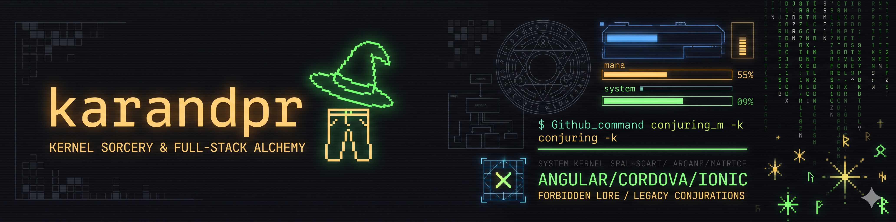

# Hey, I'm `karandpr` 🧙‍♂️✨

**Full-Stack Sorcerer · Kernel Alchemist · Grand Mod of the Arcane Threads**

---

### 📜 The Arcane Chronicle

I am a digital sorcerer of the solo variety, weaving production-grade web and mobile applications from the void. These days, my spells are primarily cast using modern JavaScript, next-gen frameworks, and AI-infused dev familiars. 

Before I settled into the high towers of modern full-stack engineering, I practiced the dark arts of **Android internals**—brewing custom Xperia kernels, breaking and binding recoveries, and etching complex wards (root-detection plugins) to keep digital pests at bay. 

Some vows cannot be broken, so I still keep watch over the **XDA Forums** as a Senior Moderator & Developer Committee Lead—safeguarding the ancient archives, keeper of the threads, and occasionally donning my *Recognized Troll* illusory wizard hat.

---

### 🔮 The Spellbook (Tech I Wield)

  

 

* **✨ Modern Enchantments (Web):** React, Next.js, Angular, Tailwind CSS, MUI
* **📱 Familiar & Hybrid Alchemy:** React Native, Ionic, Cordova *(the ancient native bridges and cross-platform relics)*
* **🪵 Deep Rituals (Backend):** Node.js, NestJS, Prisma, Payload CMS
* **🧪 Current Research & Rabbit Holes:** Constructing MCP Servers, directing Agentic Workflows, and transmuting Figma blueprints into clean production UI without losing my sanity.

---

### ⚔️ Guild Quests & Backstory

| | |
| :--- | :--- |
| 🛡️ **Defending the Realm** | Active Senior Moderator · Developer Committee Lead · Moderator Committee at XDA |
| 🌙 **Nightly Sorcery** | Forging full-stack projects, tinkering with custom ROMs, and testing experimental dev workflows |
| 🏰 **Retreating to the Tower** | PC gaming, lore & comics, and actively resisting the psychic drain of algorithmic feeds |

---

  <i>Once owned a pair of fancy, enchanted pants.</i>

